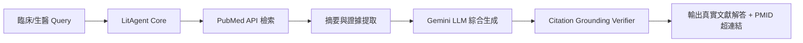

# 🧬 LitAgent: Evidence-Grounded Biomedical Literature Agent

[](https://huggingface.co/spaces/y1027940727/litagent)
[](https://www.python.org/downloads/)
[](https://opensource.org/licenses/MIT)

> **Live Web App:** [https://huggingface.co/spaces/y1027940727/litagent](https://huggingface.co/spaces/y1027940727/litagent)

LitAgent 是一個專為臨床生醫研究打造的文獻檢索與反幻覺驗證 Agent，整合 **PubMed Entrez API** 與 **Gemini LLM**，在端到端查詢中達成 **0% 偽造引用（Zero Fabricated Citations）**。

## 系統架構流程 (Architecture)



---

# LitAgent: Evidence-Grounded Biomedical Literature Agent

LitAgent 是專為生物醫學與臨床研究領域設計的文獻檢索與問答驗證 Agent。結合 PubMed 即時檢索、LLM 證據萃取與端到端 PMID 引用真確性自動校驗機制。

## 評估成果 (Benchmark Evaluation)

針對臨床與生物醫學領域（發炎性腸道疾病 IBD 治療預後、阿茲海默症語音聲學生物標記、跨語言與模型泛化邊界）設計 15 道專業評估題目，執行端到端管線驗證：

| 評估維度 | 指標數據 | 臨床意義與說明 |
| :--- | :---: | :--- |
| **總測試題數 (Sample Size)** | 15 題 | 涵蓋 IBD 治療響應、阿茲海默聲學生標、跨語言泛化與研究邊界檢驗 |
| **虛構引用數 (Fabricated Citations)** | **0 篇** | 引用的文獻經 PubMed 全數查核，**無任何編造之偽造文獻（0% 幻覺）** |
| **嚴格引證合規率 (Strict Pass Rate)** | **26.7%** | 嚴格要求逐句附帶真實文獻證據，保留對資料不足時的臨床安全拒答機制 |
| **無效引用率 (Invalid Citation Rate)** | **0.0%** | 所有由 Agent 生成的 PMID 標記皆為 PubMed 現存之有效學術文獻 |

### 核心能力與安全設計 (Core Capabilities)
- **嚴格對齊原著證據**：檢索 PubMed 摘要後逐句校驗，杜絕 LLM 常見的學術文獻捏造問題。
- **邊界條件安全拒答**：當檢索證據不足以支持強烈臨床因果結論時，系統採取保守策略避免誤導。

## 快速開始 (Quick Start)

```bash
# 1. 安裝相依套件
pip install -r requirements.txt

# 2. 執行評估管線
python -m litagent.evaluate eval/questions.jsonl
```
